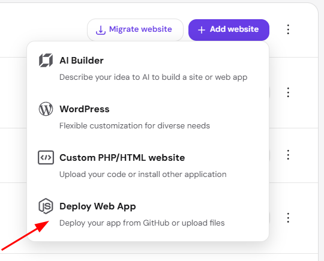
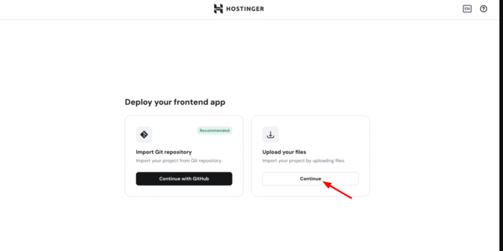
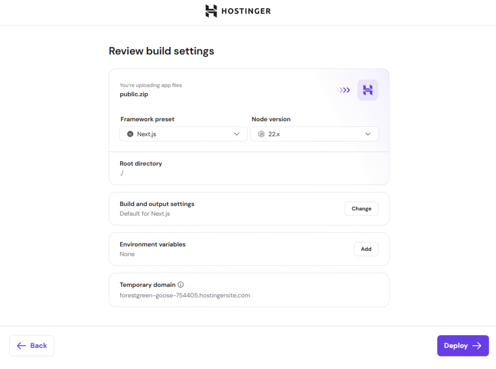
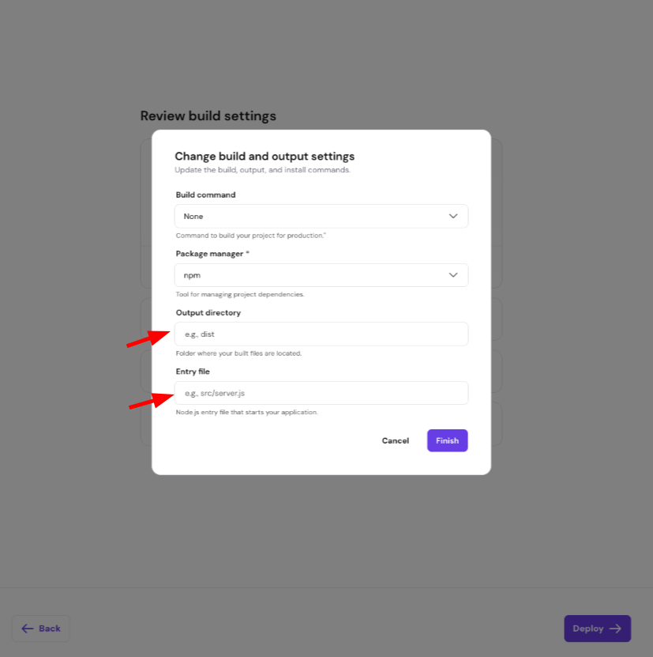

### Recommended project structure

Keep the two apps separate in your project:

my-project/
├── frontend/
│   ├── package.json
│   ├── next.config.js
│   ├── app/                 # or pages/
│   └── public/
└── backend/
    ├── package.json
    ├── nest-cli.json
    ├── tsconfig.json
    └── src/
        └── main.ts

Deploy them as  **separate apps** . Typically, the frontend uses your main domain and the API uses a hostname such as `api.yourdomain.com`. Configure the frontend to call that API hostname, and allow the frontend’s domain in NestJS CORS settings.

### Upload through Hostinger’s Node.js deployment flow

Create a separate ZIP for each app. Put that app’s files at the ZIP’s top level, including its `package.json`, and leave out `node_modules`.

1. From  **Websites** , choose  **Add Website** , then **Deploy Web App** and  **Upload your website files** .

Upload the ZIP for the app you’re deploying, then set its build options. Hostinger should detect Next.js; if NestJS isn’t listed, choose  **Other** .

1. Check that each app’s `package.json` has the right production scripts. Next.js commonly uses `next build` and `next start`. For NestJS, set the entry file to the file your build actually produces, often `dist/main.js`. Next.js can run as a Node.js server; a static export has fewer features, so use it only if your app doesn’t need server-side features. [Getting Started: Deploying | Next.js](https://nextjs.org/docs/app/getting-started/deploying)
